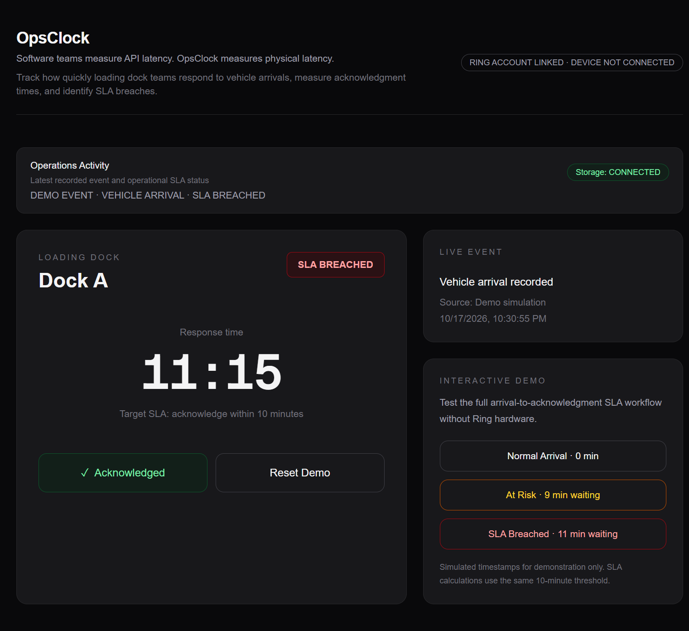
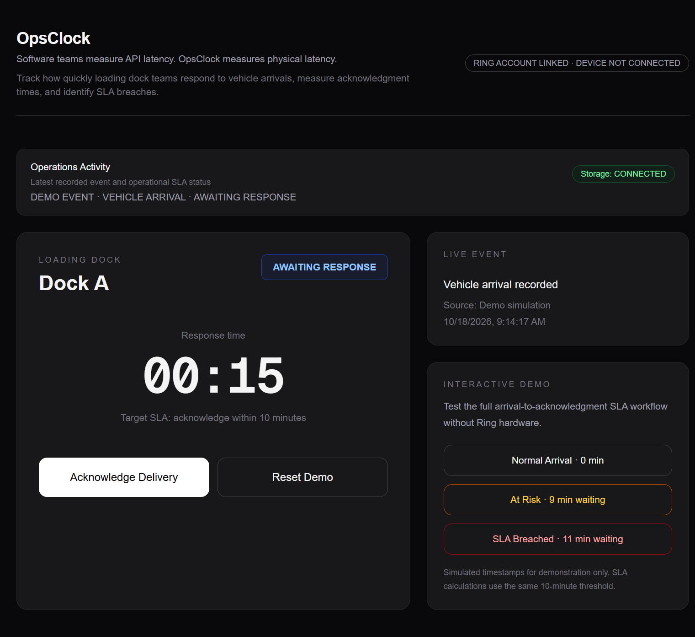
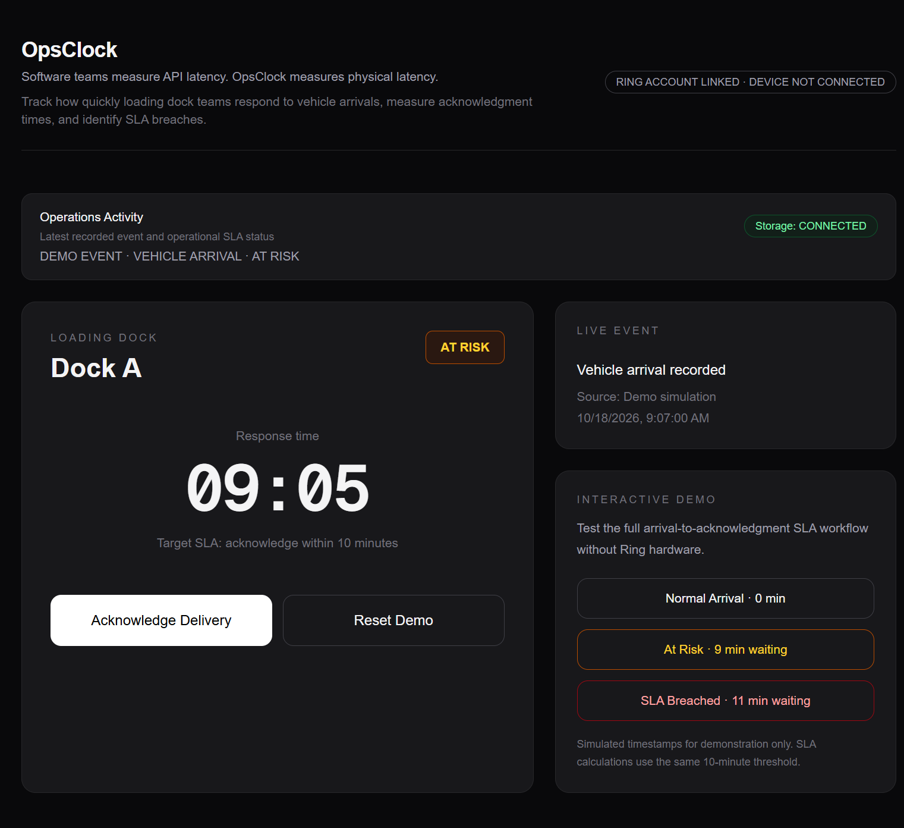
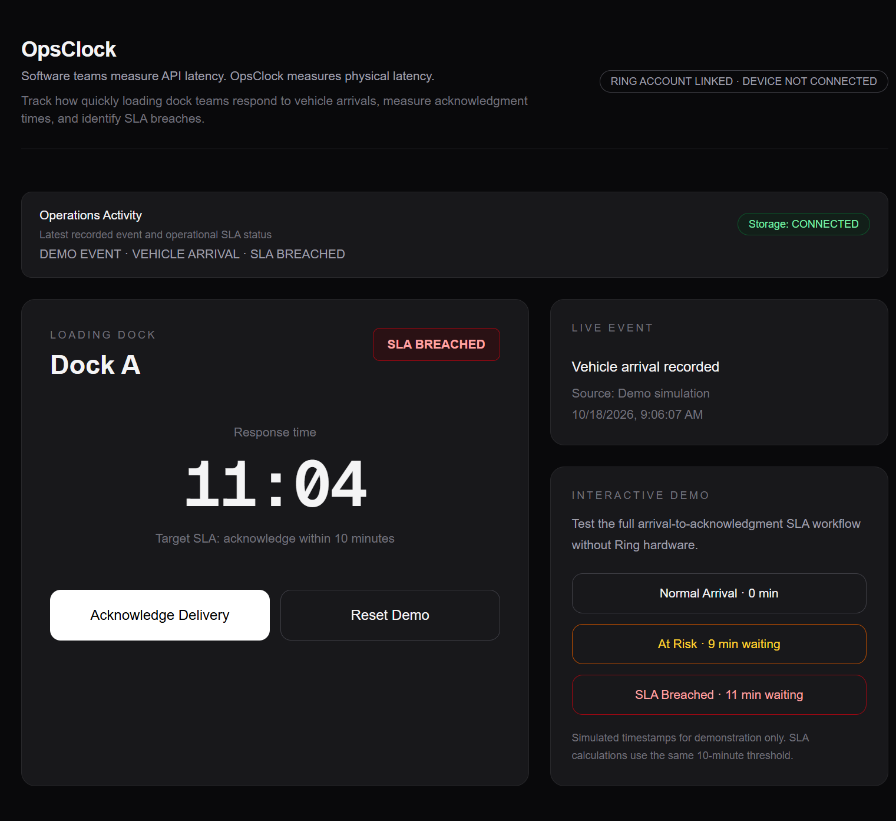
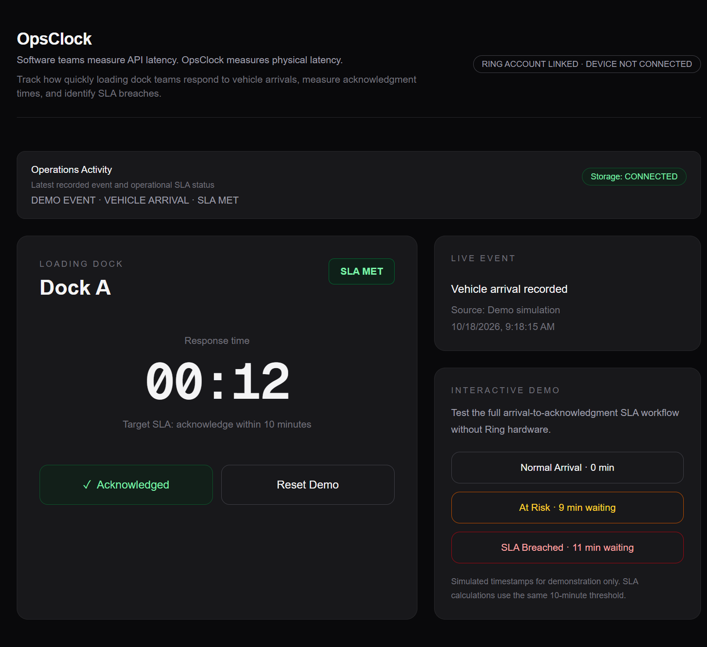
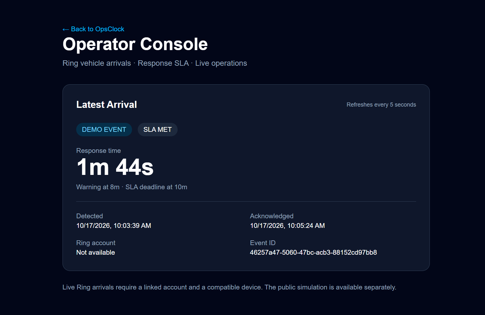

# OpsClock

**Software teams measure API latency. OpsClock measures physical latency.**

OpsClock is a physical operations observability application built for the Amazon Build, Ship, Shape 2026 hackathon.

It measures the time between a vehicle arrival and an operator's acknowledgment, making loading dock response delays visible and measurable.

**Live Application:** https://opsclock-rho.vercel.app

## Product Screenshots

OpsClock turns physical arrival events into measurable operational response times.

### 1. Operations Dashboard

### 2. Normal Arrival — Awaiting Response

A delivery arrives and the response timer starts.

### 3. At Risk — Approaching SLA Deadline

The dashboard warns operators as the response time approaches the 10-minute SLA.

### 4. SLA Breached — Response Overdue

An unacknowledged delivery exceeds the SLA threshold.

### 5. SLA Met — Acknowledged on Time

The operator acknowledges the delivery before the SLA deadline, stopping the response timer.

---

## The Problem

Software systems have tools to measure latency, uptime, and errors. Physical operations often lack similar visibility into how quickly people respond to real-world events.

When a vehicle arrives at a loading dock, teams need to know when it arrived, how long acknowledgment took, and whether the response met operational targets.

OpsClock turns that response time into an observable metric.

## Key Features

- Live response timer for loading dock events
- SLA warning at 8 minutes
- SLA breach detection at 10 minutes
- Operator acknowledgment workflow
- Persistent event storage with Upstash Redis
- Session-isolated interactive demo
- Three selectable SLA simulation scenarios
- Ring account-linking and OAuth integration
- Ring webhook ingestion endpoint

## SLA Logic

| Condition | Status |
| --- | --- |
| No event | IDLE |
| Waiting less than 8 minutes | AWAITING_RESPONSE |
| Waiting 8 to under 10 minutes | AT_RISK |
| Acknowledged within 10 minutes | SLA_MET |
| Waiting at least 10 minutes | SLA_BREACHED |
| Acknowledged after 10 minutes | SLA_BREACHED |

A late acknowledgment never converts a breached event into a successful one.

## Interactive Demo

Visit **https://opsclock-rho.vercel.app**

The public demo works without Ring hardware.

1. Click **Reset Demo** to clear the current simulated event.
2. Select **Normal Arrival** to create a new vehicle arrival.
3. Click **Acknowledge Delivery** to record the response.
4. Reset and select **At Risk** to simulate 9 minutes of waiting.
5. Reset and select **SLA Breached** to simulate 11 minutes of waiting.
6. Acknowledge the breached event and verify that its status remains **SLA BREACHED**.

The demo uses simulated timestamps with the application's real SLA calculation logic. Simulated events are clearly labeled.

## Ring Integration

OpsClock includes the following implemented integration components:

- Ring OAuth token exchange
- Encrypted token persistence
- Operator authentication
- Ring account-linking flow
- Access-token refresh support
- Webhook endpoint
- Event processing infrastructure

### Verified Integration Status

The Ring account-linking flow was successfully completed through the Ring App Store.

However, the linked account has no eligible connected device locations. Therefore, real Ring device event delivery has not been verified.

The public interactive demo uses simulated vehicle arrivals, not live Ring camera detections.

## Architecture

    Ring Account Authorization
                |
                v
        OAuth Token Exchange
                |
                v
       Encrypted Token Storage
                |
                v
         Ring Webhook Endpoint
                |
                v
           Event Processing
                |
                v
             SLA Engine

    Interactive Demo Session
                |
                v
       Simulated Vehicle Event
                |
                v
           Upstash Redis
                |
                v
             SLA Engine
                |
                v
        Operations Dashboard
                |
                v
       Operator Acknowledgment

The interactive demo stores events separately from general operations events.

## Technology Stack

| Layer | Technology |
| --- | --- |
| Frontend | Next.js 16, React 19 |
| Language | TypeScript |
| Styling | Tailwind CSS |
| Database | Upstash Redis |
| Hosting | Vercel |
| Integration | Ring API |

## Production Testing

The following scenarios have been manually verified on the public deployment:

| Test | Result |
| --- | --- |
| Normal arrival | Passed |
| At-risk warning | Passed |
| Acknowledgment within SLA | Passed |
| SLA breach detection | Passed |
| Acknowledgment after breach | Passed |
| Response timer stops after acknowledgment | Passed |
| Reset and scenario switching | Passed |

These tests validate the interactive SLA workflow. They do not establish that physical Ring device events have been received.

## Local Development

Clone the repository:

    git clone https://github.com/zzzyyyddd/opsclock.git
    cd opsclock
    npm install

Configure the required credentials in `.env.local`, including Upstash Redis settings. Ring credentials are needed for Ring-specific integration functionality.

Start the development server:

    npm run dev

Open http://localhost:3000.

Never commit credentials, access tokens, or `.env.local`.

## Project Status

OpsClock is a deployed hackathon prototype with a working interactive SLA dashboard, persistent demo storage, operator acknowledgments, and verified Ring account linking.

Physical Ring-device event delivery remains unverified because no eligible device location is connected.

## Links

- Live Demo: https://opsclock-rho.vercel.app
- GitHub: https://github.com/zzzyyyddd/opsclock

## Operator Console

The password-protected Operator Console provides a live SLA monitoring dashboard for authorized operators.

- View the latest arrival event and its source
- Monitor SLA status and response time
- Acknowledge pending events
- Distinguish Ring events from demo events

**Ring integration status:** OAuth account linking and signed webhook processing are implemented and tested with simulated payloads. Physical Ring device event delivery has not yet been verified.
